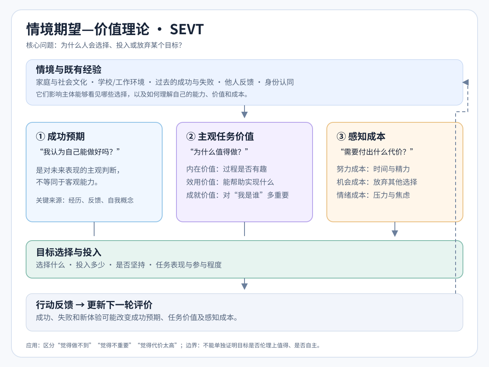

# 情境期望—价值理论（SEVT）

> [!abstract] 一句话
> 一个人是否选择和投入某项目标，与其**成功预期**、**主观任务价值**和**感知成本**密切相关；这些判断在具体的社会和任务情境中形成，并可能被新经验持续更新。

## 1. 理论回答什么问题？

为什么能力相近的人，会选择不同课程、职业和长期目标？为什么有能力做好一件事的人，仍可能不愿投入？

该理论起源于对学业及职业成就选择的研究，后来特别强调社会文化、个人发展和具体情境的作用。

**研究对象主要是动机和成就相关选择**，并非一套判断人生目标是否“应该”被追求的完整价值哲学。

## 2. 三组关键评价

### 2.1 成功预期（Expectancy for Success）

**我认为自己未来能做好吗？**

- 这是对未来表现的**主观预期**，不等于客观能力。
- 受到成功/失败经历、能力自我概念、他人反馈与任务情境的影响。
- 同样具备能力的人，因成功预期不同，可能出现不同的选择和投入程度。

### 2.2 主观任务价值（Subjective Task Value）

**我为什么认为这件事值得做？**

| 价值 | 核心含义 | 例子：学习编程 |
| --- | --- | --- |
| 内在价值（Intrinsic） | 活动过程本身带来兴趣、享受 | 喜欢解决问题和写程序 |
| 效用价值（Utility） | 有助于其他短期或长期目标 | 获得工作、开发产品 |
| 成就价值（Attainment） | 与身份认同、重要自我信念有关 | “成为创造技术的人”对我很重要 |

三者可能同时存在，也可能发生冲突。**认为一件事“有用”，不等于“喜欢”，也不等于“它符合我想成为的人”。**

### 2.3 感知成本（Perceived Cost）

**追求这个目标，我要付出或失去什么？**

- **努力成本**：时间、认知资源、体力。
- **机会成本**：选择它就无法同时投入其他目标。
- **情绪成本**：焦虑、压力、挫败等。

> [!note] 理论细节
> 成本应独立建模，还是作为主观任务价值的一部分，目前仍存在理论与测量上的争议。这里为了便于记忆，将成本单独列出。

## 3. 为什么叫“情境”？

成功预期、价值和成本不是凭空形成的稳定数字。

它们受到家庭、学校或工作环境、社会文化、身份期待、可获得的选择、资源和历史经验影响。

一个人没有选择某条道路，可能不是因为没有价值或能力，而是他**没有接触过、没有机会，或者不认为它属于自己的可行选择**。

## 4. 目标评价如何动态变化？

**过去经历 / 当前情境 → 成功预期、任务价值、成本评价 → 选择与投入 → 行动结果与新经验 → 下一轮评价。**

例如：一个人完成首个编程项目后，可能同时提升成功预期、效用价值和兴趣；后来又可能因健康、家庭责任等条件改变而提高对成本的评价。

注意：**目标内容没变，主体对目标的评价也可以变化。**

这不是严格的数值公式；不要把理论误写成「动机 = 成功概率 × 价值 − 成本」，因为不同成分的作用与交互关系仍需具体研究。

## 5. 用于理解坚持与放弃

外部同样表现为“放弃”，原因却可能完全不同：

| 观察到的状态 | 可能需要核查的原因 |
| --- | --- |
| 仍然重视，但觉得做不到 | 成功预期、资源、能力判断是否准确？ |
| 有能力做到，但不再重视 | 兴趣、效用、身份价值是否改变？ |
| 能做到且仍重视，但代价太高 | 努力、机会、情绪与其他责任能否协调？ |

**不能只根据“是否坚持”评价行动是否合理。** 要先区分发生变化的是事实判断、目标价值还是成本条件。

## 6. 理论贡献与边界

**能提供的解释：**
- 为什么人会选择、投入、坚持某些成就目标；
- 为什么相似能力的人做出不同的选择；
- 情境和经验怎样影响成功预期、价值和成本。

**不能单独证明：**
- 某个人生目标在伦理上是否值得；
- 一个决定是否真正自主；
- 所有人在所有领域的目标选择都遵循统一的精确计算公式。

> [!important] 与自主性研究的连接
> **SEVT 解释一个人为什么倾向于追求某个目标，不直接决定该目标是否合理或自主。** 下一步可将它与自我决定理论、目标调节、目标脱离和再投入研究结合。

## 7. 快速复习

**三个判断**：我能做好吗？为什么值得做？代价是什么？

**三个价值**：内在价值、效用价值、成就价值。

**一个过程**：情境和经验改变评价，评价影响行动，行动产生新的经验。

**一个区分**：成功预期变化 ≠ 价值排序变化 ≠ 成本变化。

## 8. 一手研究来源

1. Eccles, J. S., & Wigfield, A. (2024). *The Development, Testing, and Refinement of Eccles, Wigfield, and Colleagues’ Situated Expectancy-Value Model of Achievement Performance and Choice.* Educational Psychology Review, 36, 51. https://doi.org/10.1007/s10648-024-09888-9
2. Eccles, J. S., & Wigfield, A. (2020). *From expectancy-value theory to situated expectancy-value theory: A developmental, social cognitive, and sociocultural perspective on motivation.* Contemporary Educational Psychology, 61, 101859. https://doi.org/10.1016/j.cedpsych.2020.101859

---

### Obsidian 图像显示说明

本笔记使用标准 Markdown 相对路径嵌图，GitHub 与 Obsidian 均可识别。

- 图像独立存放在 `assets/sevt-overview.svg`，**不是**放在 `\`\`\`svg` 代码块内。
- 确保同步的是**整个仓库目录**，而不只是当前 `.md` 文件；否则相对路径会失效。
- 如果只在 Obsidian 中使用，也可以替换为 Obsidian 原生嵌入语法：`![[sevt-overview.svg|900]]`。
- 如果某个插件、主题或导出流程仍无法处理 SVG，再把该 SVG 导出为 PNG 并改用 `.png` 嵌入；正常 Obsidian 阅读模式无须转换。
